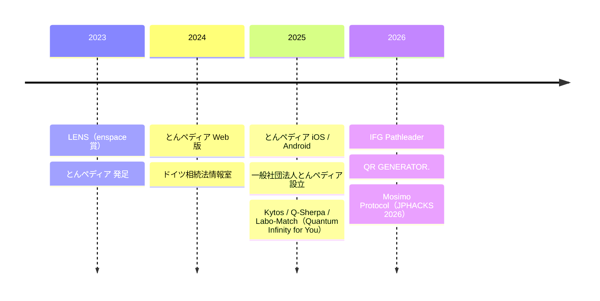
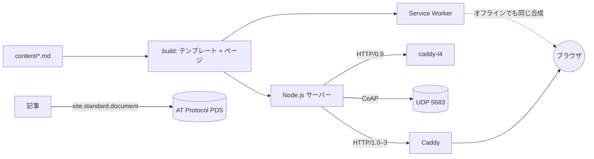

# oriom

**Web・モバイル・バックエンド・クラウド・セキュリティ、ときどき量子アニーリング**

東北大学 工学部 電気情報物理工学科 4 年 · 微小光学研究室 · [一般社団法人とんペディア](https://org.tompedia.jp/) 理事 · [Team JISAKU](https://jisaku.dev)

> [!NOTE]
> このページは [oriom.dev](https://oriom.dev) と同じ内容を GitHub 向けにまとめたものです。サイトはアクセスするたびに **1 次元・2 次元・3 次元** のどれかのデザインで表示されます。末尾に `.md` を付けると Markdown 版を読めます。

## 🏆 実績

| | プロジェクト | 担当 | 技術 |
|---|---|---|---|
| 📡 | **[Mosimo Protocol](https://mosimo.jisaku.dev/)** JPHACKS 2026 Best Audience Award ほか 7 賞 | プロトコル設計・組込・バックエンド | TypeScript · Nix · C++ · AT Protocol · Nostr |
| 🐷 | **[とんペディア](https://info.tompedia.jp/)** 東北大生のための非公式アプリ | 開発リーダー・立ち上げ・設計・アプリ・バックエンド | Flutter · Next.js · Supabase · Cloudflare |
| 🧊 | **[Kytos Orchestration](https://altema.is.tohoku.ac.jp/q_universe/apps/158/)** Quantum Infinity for You 表彰 | 設計・バックエンド・SA | Nuxt · Cloudflare · 量子アニーリング |
| ⛰️ | **[Q-Sherpa](https://altema.is.tohoku.ac.jp/q_universe/apps/156/)** Quantum Infinity for You 表彰 | バックエンド・SA・ホスティング | Next.js · Cloudflare |
| 🎓 | **[Labo-Match](https://altema.is.tohoku.ac.jp/q_universe/apps/159/)** Quantum Infinity for You 表彰 | ホスティング | Cloudflare |
| 💊 | **[IFG Pathleader](https://play.google.com/store/apps/details?id=jp.ifg.pathleader)** | シリアル通信・CI/CD・リリース | Kotlin · Ruby |
| 🔳 | **[QR GENERATOR.](https://qr.oriom.dev/)** | フロントエンド | Vue.js |
| ⚖️ | **[ドイツ相続法情報室](https://erb.tchiba.info/)** | Web サイト開発 | Astro · Netlify |
| 🏢 | **[株式会社リンクエム](https://www.linkm0403.com/)** | リファクタリング・ホスティング | Astro · Cloudflare |
| 🔍 | **[LENS](https://github.com/Lens-expand-your-horizons/LENS)** 東北大学ビジネスアイデアコンテスト enspace 賞 | 設計・Web アプリ・バックエンド | Nuxt · AWS Lambda |

<b>🗓️ 年表</b>

## 🛠️ 技術

## 🌐 oriom.dev の作り

- **1 リクエスト・512 KB 以内**：どのページ、どのデザインも、画像やスクリプトを含めて HTML 1 枚に収まります（テストで常に検査）。
- **毎回違う色**：OKLCH の明度と彩度を全色相で検証済みの値に固定し、色相だけをランダムにしています。どの色でも文字のコントラストは 7:1 以上です。
- **standard.site**：記事は AT Protocol のレコードとしても公開し、Team JISAKU の記事もこのサイトから読めます。

### 進捗

- [x] コンテンツのパイプライン（Markdown → テンプレート × ページ、`.md` 版）
- [x] 全色相で検証した OKLCH パレット
- [x] 512 KB・1 リクエストの自動検査
- [x] 1 次元デザイン（一筆書きのベジェ曲線）
- [x] 2 次元デザイン（技術の DAG を自由スクロール）
- [ ] 3 次元デザイン（ノイズ生成のボクセル世界・WebGPU / WebGL 2）
- [x] サーバー（HTTP/0.9–3、CoAP、ランダム配信、ライブ統計）
- [x] Service Worker / PWA（完全オフライン）
- [ ] standard.site への公開とチーム記事の集約
- [ ] Open Badges の検証
- [ ] VPS へのデプロイ

---

この README は <a href="https://github.com/oriom-dev/oriom-dev">oriom-dev/oriom-dev</a> のサイトのソースと一緒に管理しています。

