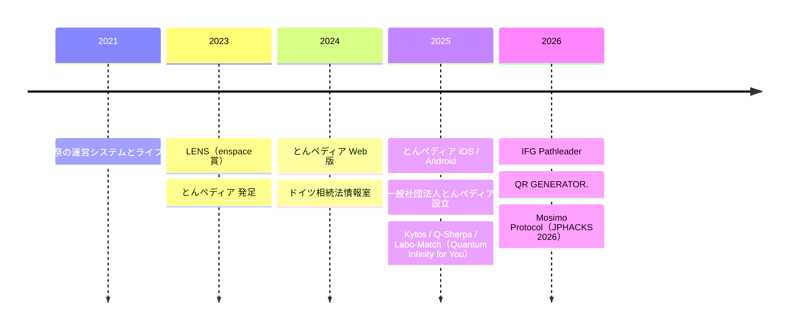

# oriom

**Web・モバイル・バックエンド・クラウド・セキュリティ、ときどき量子アニーリング**

東北大学 工学部 電気情報物理工学科 4 年 · 微小光学研究室 · [一般社団法人とんペディア](https://org.tompedia.jp/) 理事（開発担当） · [Team JISAKU](https://jisaku.dev)

研究では 3D Gaussian Splatting を、課外では量子アニーリングを触っています。作るものに合わせて、フロントエンドから組込、インフラまでどこからでも手を動かします。

> [!TIP]
> 実績や記事は [oriom.dev](https://oriom.dev) にもまとめています。

## 🏆 実績

| | プロジェクト | 担当 | 技術 |
|---|---|---|---|
| 📡 | **[Mosimo Protocol](https://mosimo.jisaku.dev/)** JPHACKS 2026 Best Audience Award ほか | プロトコル設計・組込・バックエンド | TypeScript · Nix · C++ · AT Protocol · Nostr |
| 🐷 | **[とんペディア](https://info.tompedia.jp/)** 東北大生のための非公式アプリ | 開発リーダー・立ち上げ・設計・アプリ・バックエンド | Flutter · Next.js · Supabase · Cloudflare |
| 🧊 | **[Kytos Orchestration](https://altema.is.tohoku.ac.jp/q_universe/apps/158/)** Quantum Infinity for You 表彰 | 設計・バックエンド・SA | Nuxt · Cloudflare · 量子アニーリング |
| ⛰️ | **[Q-Sherpa](https://altema.is.tohoku.ac.jp/q_universe/apps/156/)** Quantum Infinity for You 表彰 | バックエンド・SA・ホスティング | Next.js · Cloudflare |
| 🎓 | **[Labo-Match](https://altema.is.tohoku.ac.jp/q_universe/apps/159/)** Quantum Infinity for You 表彰 | ホスティング | Cloudflare |
| 💊 | **[IFG Pathleader](https://play.google.com/store/apps/details?id=jp.ifg.pathleader)** | シリアル通信・CI/CD・リリース | Kotlin · Ruby |
| 🔳 | **[QR GENERATOR.](https://qr.oriom.dev/)** | フロントエンド | Vue.js |
| ⚖️ | **[ドイツ相続法情報室](https://erb.tchiba.info/)** | Web サイト開発 | Astro · Netlify |
| 🏢 | **[株式会社リンクエム](https://www.linkm0403.com/)** | リファクタリング・ホスティング | Astro · Cloudflare |
| 🔍 | **[LENS](https://github.com/Lens-expand-your-horizons/LENS)** 東北大学ビジネスアイデアコンテスト enspace 賞 | 設計・Web アプリ・バックエンド | Nuxt · AWS Lambda |
| 🎭 | **国高祭の運営システムとライブ配信** 都立国立高校 文化祭（2021 年度） | 予約・抽選・入場管理システムの構築と運用、体育館全体のライブ配信 | PHP · JavaScript · nginx · OBS |

<b>🗓️ 年表</b>

## 🏅 バッジ

| バッジ | 発行者 | 発行日 |
|---|---|---|
| [数理・情報・データサイエンス・AI リテラシー](https://www.openbadge-global.com/api/v1.0/openBadge/v2/Wallet/Public/GetAssertionShare/WDBZTDR3Zm40VlhRc3F0NmFMM1R6dz09) | 東北大学 | 2023-08-23 |
| [Quantum Business for you（量子コンピュータ実践的スタートアップ創出講座）](https://www.openbadge-global.com/api/v1.0/openBadge/v2/Wallet/Public/GetAssertionShare/M1pLTDNESFVBR2JGWFJWK0pMZSszZz09) | 東北大学大学院情報科学研究科 | 2024-10-01 |

## 🛠️ 技術

<b>🧪 研究・興味</b>

- 3D Gaussian Splatting（微小光学研究室）
- 量子アニーリング・シミュレーテッドアニーリングによる組合せ最適化（コンテナ配置、マッチング、班分け）
- 災害時の端末間通信（store / carry / forward、AT Protocol と Nostr）
- 自宅と VPS をつないだ Podman クラスタの運用

